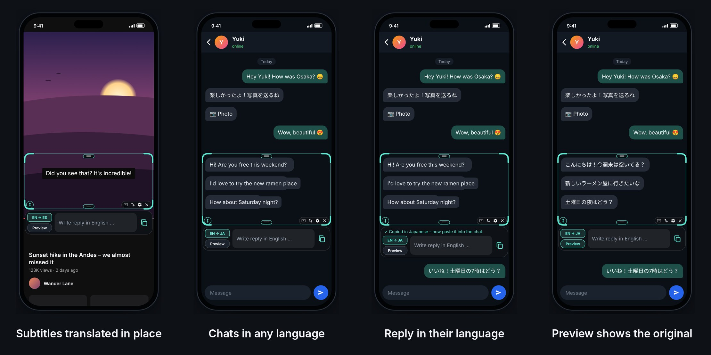

# SubLens

**Live screen translation for Android.** A transparent lens you drag over YouTube subtitles, chats or any other text on screen. The translation appears right on top of the original, in its colours and at roughly its size. Reply in the other person's language with one tap.

Free, open source, fully offline. No account, no ads, nothing leaves your phone.

🎬 [Watch the 40-second demo](docs/demo.mp4)

## ⬇️ Download

### 👉 [**Download SubLens.apk**](https://github.com/Elphax89/sublense/releases/latest/download/SubLens.apk)

Download page with instructions: **https://elphax89.github.io/sublense/**

1. Open the link on your Android phone and open the downloaded file.
2. The first time, Android asks whether your browser may install apps → **Allow**.
3. Tap **Install**. If Play Protect warns you, tap *Install anyway* (the app isn't from the Play Store).
4. Open SubLens, allow **Display over other apps**, then tap **Start translator**.

> **Switch greyed out ("Controlled by restricted setting")?** Android protects apps from outside the Play Store this way. Unlock it once: *Settings → Apps → SubLens → ⋮ (top right) → Allow restricted settings*, then turn on *Display over other apps*. [Google's guide](https://support.google.com/android/answer/12623953)

**Updates:** SubLens checks for new versions by itself. The button at the bottom of the app turns into *New version available – install now?*. One tap downloads and installs it, and your settings are kept. The first time, Android asks you to let SubLens install apps.

## Features

- 🔍 **Translation right in the lens.** Every text block is replaced where it is, in the colours of the original. Longer translations grow sideways instead of shrinking.
- 💬 **Subtitles, chats, any text.** Works on top of YouTube, Telegram, WeChat, websites, games and other apps.
- ✍️ **Reply line.** Type in your own language and tap copy. The translation into the chat's language is on your clipboard, ready to paste.
- 🎬 **Chat mode and video mode.** In chat mode (default) SubLens ignores GIFs, animated emojis and profile pictures, so translations stay perfectly still. Tap ▶ on the lens for video mode: moving pictures are read continuously so subtitles keep up.
- 👁️ **Preview.** Shows the original text until you tap it again. Tapping a single translation shows its original for 3 seconds.
- 🔲 **A lens you can move and resize.** Always full screen width, in portrait and landscape. Drag the top or bottom handle to change the height (from 1/5 of the screen up to nearly all of it), drag the ↕ button to move it. ▶ ⇅ ⚙ ✕ sit in the bottom right corner; ⇅ moves the reply line above or below the lens when there is room.
- 🌍 **50+ languages** with automatic detection, and a ⇅ button to swap From and To. Chinese is shown in traditional characters.
- 🎨 **Your lens colour.** Pick one of nine colours for the frame and handles.
- 📴 **Offline.** Text recognition, language detection and translation run on the phone (Google ML Kit). Each language pack downloads once (about 30 MB), and you can download any pack by hand, for example before a trip.
- 🔒 **Private.** No server, no account. Screen frames only live briefly in memory and are never saved.
- 🌐 **The app speaks your phone's language:** English, German, Spanish, French, Italian, Portuguese, Polish, Turkish, Russian, Chinese, Japanese and Korean.

## How to use it

**Subtitles:** open YouTube, turn on captions (CC) and move the lens over them. The translation replaces the subtitle.

**Chats:** put the lens over the messages. To answer, tap the reply line under the lens, write in your language, tap the copy button (or *Done* on the keyboard) and paste into the chat.

**Stop:** ✕ on the lens or *Stop* in the notification.

Android asks for screen sharing every time SubLens starts. Choose **Entire screen**, not a single app, or the lens won't line up with the text.

## Settings

| Area | Options |
|---|---|
| Language | From (automatic or fixed), To, swap ⇅, script for automatic detection |
| Display | Lens colour, translation in the lens or in a bar next to it, bar position, text size, show original |
| Reply line | On/off, reply language (automatic = detected language), above or below the lens (⇅ on the lens) |
| Refresh | Fast 0.3 s · Normal 0.5 s · Battery saver 1 s |
| Language packs | Wi-Fi only, download any language, delete packs |

## Good to know

- **Android 8 or newer.** iOS doesn't allow overlays on top of other apps.
- **Brief flicker.** When something changes under the lens, SubLens hides the affected translations for a split second to read the screen again. Only the part that moved is re-read; everything else stays still. In video mode this happens about every 0.6 s over a playing video. If that bothers you, show the translation in the bar instead.
- **Protected apps.** Netflix, Disney+ and banking apps block screen sharing, so SubLens sees nothing there.
- **Scripts.** Text recognition reads Latin, Chinese, Japanese, Korean and Devanagari script. Cyrillic, Arabic, Greek, Hebrew and Thai work as target languages only.
- **Traditional Chinese** output needs Android 10 or newer; older phones get simplified characters.
- Text recognition runs through Google Play services and downloads its model once on first start.

---

## For developers

Plain Kotlin, no extra frameworks. Every push to `main` runs [`build.yml`](.github/workflows/build.yml): it builds the APK, publishes it as the latest release (`SubLens.apk`) and deploys the download page from `docs/` to GitHub Pages (*Settings → Pages → Source: GitHub Actions*).

Build locally (JDK 17 + Android SDK): `./gradlew assembleRelease`, or open the folder in Android Studio.

Releases are signed with a private key that lives only in the repository's GitHub Secrets (`SIGNING_KEYSTORE_BASE64`, `SIGNING_PASSWORD`), never in the code. If you fork this, create your own key with `keytool -genkeypair -keystore release.jks -alias sublens -keyalg RSA -keysize 4096 -validity 36500`, use the same password for store and key, and add both secrets (the keystore as `base64 -w0 release.jks`). Without them the workflow stops with a clear message; local `./gradlew assembleDebug` works with Android's debug key.

| File | Purpose |
|---|---|
| `MainActivity.kt` | Home screen, permissions, settings, language packs, updates |
| `OverlayService.kt` | Foreground service, screen sharing, capture loop (re-reads only what changed; learns and ignores animations in chat mode) |
| `OverlayController.kt` | Overlay windows: lens, handles, ⚙/✕, quick settings |
| `LensLayer.kt` | Draws translations over the original text (one small window per block) |
| `TextPipeline.kt` | Text recognition → language detection → translation, with colours and positions |
| `ScreenCapturer.kt` | Reads the screen, crops the lens area, change detection |
| `ComposerWindow.kt` | Reply line: input, keyboard, preview |
| `ReplyTranslator.kt` | Translates your reply for the clipboard |
| `ChineseScript.kt` | Simplified ↔ traditional Chinese |
| `Updater.kt` | Checks GitHub releases and installs updates |
| `Prefs.kt`, `Languages.kt` | Settings, language lists |

## License

[MIT](LICENSE) © Elphax89
