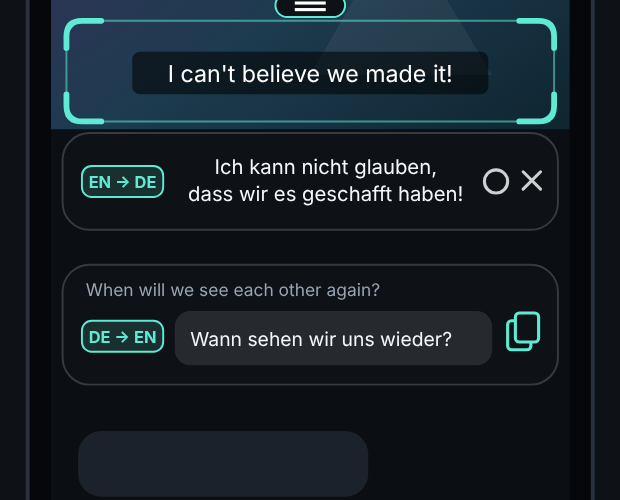

# SubLens

**Live-Übersetzung als Overlay für Android – für YouTube-Untertitel, Chats und jeden Text am Bildschirm.**
Komplett offline, kostenlos, ohne Konto und ohne Werbung.

## ⬇️ Herunterladen

### 👉 [**SubLens.apk herunterladen**](https://github.com/Elphax89/sublense/releases/latest/download/SubLens.apk)

Oder über die Download-Seite mit Anleitung: **https://elphax89.github.io/sublense/**

1. Link am Android-Handy öffnen und die Datei öffnen.
2. Android fragt beim ersten Mal, ob der Browser Apps installieren darf → **Zulassen**.
3. **Installieren** tippen. Warnt Play Protect, auf *Trotzdem installieren* tippen (die App kommt nicht aus dem Play Store).
4. SubLens öffnen, „Über anderen Apps anzeigen“ erlauben, **Übersetzer starten**.

> **Ist der Schalter grau („Gesteuert durch beschränkte Einstellung“)?** Das ist Androids Schutz für Apps außerhalb des Play Stores. Einmal freischalten: *Einstellungen → Apps → SubLens → ⋮ (oben rechts) → **Eingeschränkte Einstellungen zulassen*** (Handy-Code bestätigen), danach den Schalter „Über anderen Apps anzeigen“ einschalten. [Googles Anleitung](https://support.google.com/android/answer/12623953)

Updates installierst du genauso: Die neue APK einfach über die alte installieren, Einstellungen bleiben erhalten.

---

## Funktionen

- 🔲 **Rahmen** – durchsichtig, immer bildschirmbreit, im Hoch- und Querformat. An der Leiste verschieben, am Griff die Höhe ändern (mindestens 1/5 des Bildschirms). Berührungen gehen durch zur App darunter.
- 🔍 **Übersetzung direkt in der Linse** – jeder Textblock wird an seiner Stelle ersetzt, in ähnlicher Größe und Farbe wie das Original. Antippen zeigt 3 Sekunden das Original. Ändert sich unter der Linse etwas, blendet sie sich für einen Augenblick aus, um neu zu lesen.
- 💬 **Oder in der Leiste** – wahlweise unter oder über dem Rahmen, ganz ohne Blinken. Das Kürzel zeigt die Sprachen, z. B. `EN → DE`.
- ✍️ **Antwortzeile** (optional) – in deiner Sprache schreiben, Kopieren tippen. Die Übersetzung in die Sprache des Chats liegt dann in der Zwischenablage, fertig zum Einfügen in Telegram, WeChat & Co.
- 🌍 **Über 50 Sprachen** mit automatischer Erkennung.
- ⚙️ **Schnell-Einstellungen** direkt im Overlay: Quell- und Zielsprache, Antwortsprache, Leiste oben/unten, Antwortzeile an/aus.
- 📴 **Offline** – Texterkennung, Spracherkennung und Übersetzung laufen am Handy (Google ML Kit). Jedes Sprachpaket wird nur einmal geladen (ca. 30 MB).
- 🔒 **Privat** – kein Server, kein Konto. Die Bilder der Bildschirmfreigabe liegen nur kurz im Arbeitsspeicher und werden nie gespeichert.
- 💾 Position und Größe des Rahmens werden getrennt für Hoch- und Querformat gemerkt.

## So benutzt du es

**Untertitel:** YouTube öffnen, Untertitel (CC) einschalten, den Rahmen über die Untertitel ziehen. Die Übersetzung erscheint in der Leiste.

**Chats:** Rahmen über die Nachrichten legen. Zum Antworten unten in die Antwortzeile tippen, in deiner Sprache schreiben, auf das Kopier-Symbol (oder *Fertig* auf der Tastatur) tippen, dann im Chat einfügen.

**Beenden:** ✕ in der Leiste oder „Beenden“ in der Benachrichtigung.

## Einstellungen in der App

| Bereich | Optionen |
|---|---|
| Sprache | Von (automatisch oder fest), Nach, Schrift für die automatische Erkennung |
| Anzeige | Übersetzung in der Linse oder in der Leiste, Leiste über/unter dem Rahmen, Textgröße, Original zusätzlich anzeigen |
| Antwortzeile | an/aus, Antwortsprache (automatisch = erkannte Sprache) |
| Aktualisierung | Schnell 0,3 s · Normal 0,5 s · Akku sparen 1 s |
| Sprachpakete | Nur über WLAN laden, geladene Pakete anzeigen und löschen |

## Gut zu wissen

- Android verlangt bei jedem Start erneut die Bildschirmfreigabe – dort **Gesamter Bildschirm** wählen.
- Nur für Android 8 oder neuer. iOS erlaubt keine Overlays über anderen Apps.
- Netflix, Disney+ und Banking-Apps sperren die Bildschirmfreigabe, dort wird nichts erkannt.
- Die Texterkennung liest lateinische, chinesische, japanische, koreanische und Devanagari-Schrift. Kyrillisch, Arabisch, Griechisch, Hebräisch und Thai sind nur als Zielsprache möglich.
- Die Texterkennung läuft über die Google Play-Dienste und lädt ihr Modell beim ersten Start einmalig nach.

---

## Für Entwickler

Kotlin, ohne weitere Frameworks. Bei jedem Push auf `main` baut [`build.yml`](.github/workflows/build.yml) die APK, veröffentlicht sie als neuestes Release (`SubLens.apk`) und aktualisiert die Download-Seite aus `docs/` auf GitHub Pages (*Settings → Pages → Source: GitHub Actions*).

Lokal bauen (JDK 17 + Android SDK): `./gradlew assembleRelease` – oder den Ordner in Android Studio öffnen.

Die APK ist mit dem Schlüssel in `signing/` signiert, damit Updates über die alte Version installieren. Für den Play Store einen eigenen, geheimen Schlüssel verwenden.

| Datei | Aufgabe |
|---|---|
| `MainActivity.kt` | Startseite, Berechtigungen, Einstellungen, Sprachpakete |
| `OverlayService.kt` | Vordergrund-Dienst, Bildschirmfreigabe, Takt der Erkennung |
| `OverlayController.kt` | Overlay-Fenster: Rahmen, Leiste, Griff, Schnell-Einstellungen |
| `ComposerWindow.kt` | Antwortzeile: Eingabe, Tastatur, Vorschau |
| `FrameView.kt` | Zeichnet den Rahmen |
| `ScreenCapturer.kt` | Liest das Bild und schneidet den Rahmen-Bereich aus |
| `TextPipeline.kt` | Texterkennung → Spracherkennung → Übersetzung, mit Cache |
| `ReplyTranslator.kt` | Übersetzt die eigene Antwort für die Zwischenablage |
| `Prefs.kt`, `Languages.kt` | Einstellungen, Sprachlisten |

## Lizenz

[MIT](LICENSE) © Elphax89
